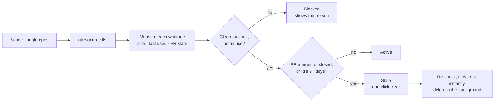
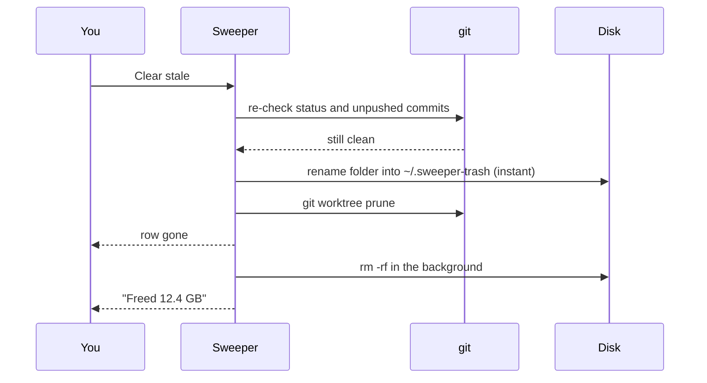

<p align="center">
  
</p>

<p align="center">
  
  
  
</p>

A macOS app that finds stale git worktrees, build output and developer caches, and clears them in one click.

Worktrees pile up. Each one carries its own `node_modules` and Rust `target/`, so a few dozen of them quietly eat 50-100 GB. Sweeper shows every worktree on your machine sorted by size, tells you which ones are safe to delete, and clears them without touching anything that has unpushed or uncommitted work.

## How it decides



PR state comes from the GitHub CLI (`gh`). A squash-merged branch whose remote was deleted still counts as pushed when its PR head matches the local commit.

## How a delete works



Branches are never deleted, only the worktree folders.

## Worktrees

Every git worktree under your home folder, across all repos, sorted by size.

| Column | What it tells you |
| --- | --- |
| Size | Total on disk. Hover to split it into source, `node_modules` and Rust `target/` |
| PR | Number and state (open, merged, closed). Click to open it on GitHub |
| Last used | When HEAD or the reflog last moved, so a stale tree looks stale even if a tool touched its files |
| Status | `safe` with the reason it is stale, or what blocks removal: uncommitted files, unpushed commits, in use, main checkout |

What you can do:

- **Clear stale**: one click removes every worktree that is safe and stale.
- **Select stale / Select all** with checkboxes, then **Remove** or **Slim** in bulk.
- **Slim** deletes only `node_modules` and Rust `target/`, keeping the worktree. The next install or build brings them back.
- **Remove** works on in-use or dirty worktrees too, after a warning that names what will break or be lost.
- **Delete a whole repo** by removing its main checkout. The dialog lists its linked worktrees, the commits no remote has, and its stashes, and stays locked until you tick "I understand".

## Caches

Shared caches that grow without bound, sorted by size. Everything here is re-downloaded or rebuilt on demand, so clearing costs time, not data.

| Cache | Location | Cleared with |
| --- | --- | --- |
| Rust build output | `target/` in worktrees not in use | delete |
| Cargo registry | `~/.cargo/registry/{cache,src}` | delete |
| Cargo git dependencies | `~/.cargo/git/{checkouts,db}` | delete |
| npm | `~/.npm/_cacache`, `~/.npm/_npx` | delete |
| pnpm store | `pnpm store path` | `pnpm store prune` |
| pnpm metadata | `~/Library/Caches/pnpm` | delete |
| bun | `~/.bun/install/cache` | delete |
| uv | `~/.cache/uv` | delete |
| pip | `~/Library/Caches/pip` | delete |
| Go modules and build cache | `~/go/pkg/mod`, `~/Library/Caches/go-build` | `go clean -modcache -cache` |
| Playwright browsers | `~/Library/Caches/ms-playwright` | delete |
| Hugging Face models | `~/.cache/huggingface` | delete (large to re-download) |
| Homebrew downloads | `~/Library/Caches/Homebrew` | `brew cleanup --prune=all` |
| TypeScript type cache | `~/Library/Caches/typescript` | delete |
| node-gyp headers | `~/Library/Caches/node-gyp` | delete |

Caches that are not on your machine are not listed.

## Disk

Everything else that takes space, for when it is not a worktree or a cache.

- **Folders**: a drill-down map of your home folder (plus `/Applications`), sorted by size. Folders fill in as each one is measured, so big trees do not block the view.
- **Large files**: every file over 500 MB in your home folder (outside `node_modules` and `.git`): videos, disk images, VM files, old installers.
- **Delete** moves to Trash by default, or deletes permanently. **Empty Trash** is one button away, since Trash does not free space until it is emptied.
- **Protected**: your home folder, `~/Library`, `~/.ssh`, `~/.gnupg`, `~/.aws`, `~/.config`, `~/.kube`, `~/.docker`, `~/.cargo`, `~/.rustup` and `/Applications` itself cannot be deleted. Things inside them can.
- **Full Disk Access**: without it, Desktop, Documents, Downloads, Movies, Music, Pictures and other apps' data show as locked rows instead of setting off a permission prompt per folder. Grant it once and they are measured like everything else.

## Safety

- **Clear stale** only removes worktrees that are clean, fully pushed, not in use, and either have a merged or closed PR or have been idle for 7+ days. Each one is re-checked right before deletion, so a commit made since the scan is never lost.
- Branches are always kept.
- A delete first moves the folder out in a single rename, then deletes it in the background, so a slow or interrupted delete does not leave a half-deleted worktree behind. (Worktrees on a different disk from your home folder are deleted in place.)
- Anything riskier needs an explicit confirmation that lists what will be lost.

## Auto-sweep

The clock button in the toolbar installs a daily LaunchAgent (12:30) that runs the same safe sweep, deletes Rust targets idle for 3+ days, and prunes the pnpm store. It logs to `~/Library/Logs/Sweeper.log`.

## Install

Download the DMG, open it, and drag Sweeper into Applications. Or build it yourself (below).

If the build is not notarized, macOS blocks the first launch. Open System Settings > Privacy & Security and click **Open Anyway** once.

Then, for the Disk tab: System Settings > Privacy & Security > Full Disk Access, click **+**, pick Sweeper, and reopen it.

Requirements: macOS 14+, `git`. The GitHub CLI (`gh`, logged in) is optional and only used for PR state.

## Privacy

Sweeper runs entirely on your Mac. The only network call is `gh pr list`, which asks GitHub for the PR state of your own repos. No analytics, no accounts.

## Build

Requires macOS 14+ and the Swift toolchain (Xcode or Command Line Tools).

```sh
./build.sh      # builds, signs, and installs to /Applications
./release.sh    # builds dist/Sweeper-<version>.dmg
```

Signing uses the first "Developer ID Application" identity in your keychain, or ad-hoc if there is none. Set `SIGN_IDENTITY` to pick one, and `NOTARY_PROFILE` (a `notarytool store-credentials` profile) to notarize the DMG.
