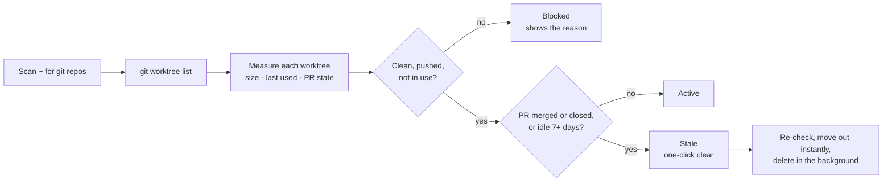
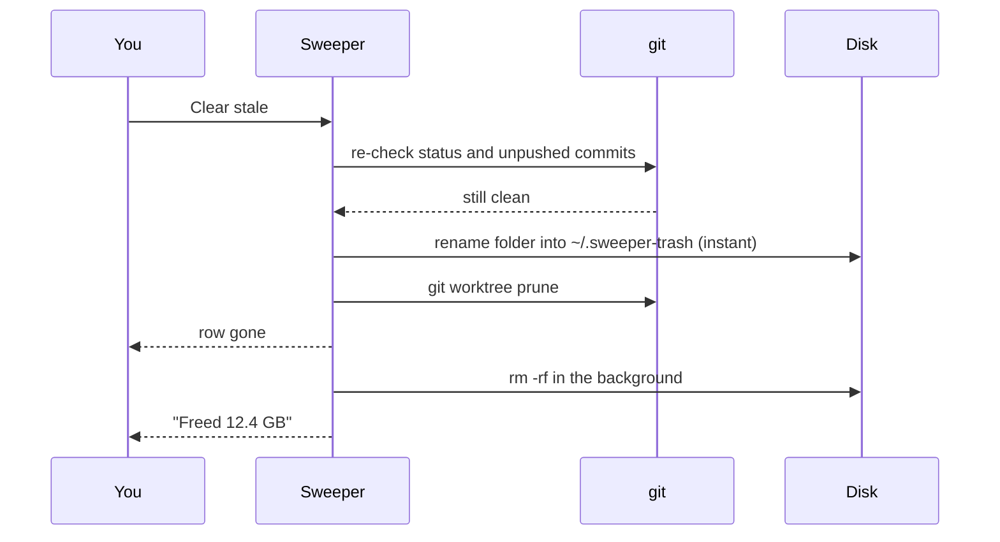

<p align="center">
  
</p>

<p align="center">
  
  
  
</p>

A macOS app that finds stale git worktrees, build output and developer caches, and clears them in one click.

Worktrees pile up. Each one carries its own `node_modules` and Rust `target/`, so a few dozen of them quietly eat 50-100 GB. Sweeper shows every worktree on your machine sorted by size, tells you which ones are safe to delete, and clears them without touching anything that has unpushed or uncommitted work.

## How it decides



PR state comes from the GitHub CLI (`gh`). A squash-merged branch whose remote was deleted still counts as pushed when its PR head matches the local commit.

## How a delete works



Branches are never deleted, only the worktree folders.

## What it shows

- **Worktrees** across every repo in your home folder, sorted by size, with the PR state (via `gh`), when each was last used, and whether removing it would lose anything (uncommitted files, unpushed commits, a running process).
- **Caches**: Rust `target/` dirs, Cargo, npm, pnpm, bun, uv, pip, Go, Playwright, Hugging Face and Homebrew, each with a one-click clear.
- **Disk**: a drill-down map of your home folder and a list of files over 500 MB.

## Safety

- **Clear stale** only removes worktrees that are clean, fully pushed, not in use, and either have a merged or closed PR or have been idle for 7+ days. Each one is re-checked right before deletion.
- Branches are always kept.
- Anything riskier (in-use worktrees, uncommitted work, a whole repo) needs an explicit confirmation that lists what will be lost.

## Auto-sweep

The clock button in the toolbar installs a daily LaunchAgent (12:30) that runs the same safe sweep, deletes Rust targets idle for 3+ days, and prunes the pnpm store. It logs to `~/Library/Logs/Sweeper.log`.

## Build

Requires macOS 14+ and the Swift toolchain (Xcode or Command Line Tools).

```sh
./build.sh      # builds, signs, and installs to /Applications
./release.sh    # builds dist/Sweeper-<version>.dmg
```

Signing uses the first "Developer ID Application" identity in your keychain, or ad-hoc if there is none. Set `SIGN_IDENTITY` to pick one, and `NOTARY_PROFILE` (a `notarytool store-credentials` profile) to notarize the DMG.

For the Disk tab to see Desktop, Documents, Downloads and other protected folders, add Sweeper under System Settings > Privacy & Security > Full Disk Access.
